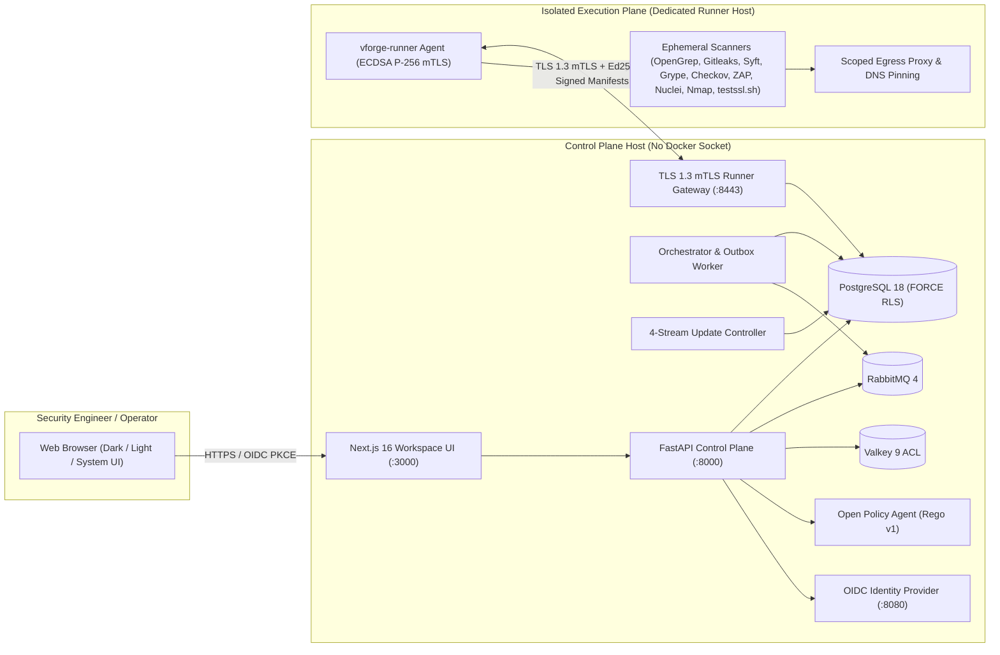

# VForge — Enterprise Cloud & Application Security Control Plane

[](LICENSE)
[](apps/api/pyproject.toml)
[](apps/web/package.json)
[](infrastructure/postgres/01-role-separation.sql.example)
[](policies/rego/vforge)

**VForge** is an open-source, self-hosted Application Security Posture Management (ASPM), VAPT orchestration, and Threat Intelligence Control Plane. It is engineered around strict **Control Plane / Execution Plane separation**, cryptographic target scope governance (`Ed25519`), database-enforced multi-tenant isolation (`ENABLE` + `FORCE ROW LEVEL SECURITY`), and isolated ephemeral scanner containers communicating over **TLS 1.3 mutual TLS (mTLS)**.

---

## Architecture Overview



---

## Key Capabilities

| Domain | Capabilities Implemented |
|---|---|
| **Multi-Tenant Identity & Zero-Trust DB** | OIDC Authorization Code Flow with PKCE (`S256`), RP-Initiated Logout, HTTP-only session cookies, CSRF tokens, and PostgreSQL 18 `ENABLE` + `FORCE ROW LEVEL SECURITY` across 63 tenant tables under least-privilege runtime role `vforge_app` (`NOSUPERUSER NOBYPASSRLS`). |
| **Target Scope & Policy Engine** | Canonical domain/IP/CIDR/URL scope validation (`vforge_scope`), SSRF/IMDS/rebinding blocks (`169.254.169.254`, link-local, RFC1918 gates), Open Policy Agent (`policies/rego/vforge/`), and `Ed25519`-signed immutable `scope_snapshots`. |
| **Isolated mTLS Runner & Scanners** | Control Plane never mounts `/var/run/docker.sock`. Dedicated `vforge-runner` authenticates via `ECDSA P-256` SPIFFE client certificates (`spiffe://vforge/org/<id>/runner/<id>`), verifies signed job manifests, and executes `@sha256` digest-pinned containers (`OpenGrep`, `Gitleaks`, `Syft`, `Grype`, `Checkov`, `OWASP ZAP`, `Nuclei`, `Nmap`, `testssl.sh`) with `read_only: true`, `cap_drop: [ALL]`, and `no-new-privileges:true`. |
| **Findings, Triage & Reporting** | Multi-scanner finding correlation preserving raw evidence occurrences, SLA breach tracking, 4-eyes Segregation of Duties (SoD) risk exceptions, `AES-256-GCM` envelope-encrypted artifacts, and multi-format report exports (`HTML`, `PDF`, `JSON`, `SARIF 2.1.0`). |
| **Threat Intel & OSINT Correlation** | Offline-capable **CISA KEV**, **FIRST EPSS**, **NVD CVE 2.0**, **OSV**, and **Exploit-DB** feeds with stale-data degradation, plus multi-source OSINT compromise lookups (**Hudson Rock Cavalier v2**, **XposedOrNot**, **ProxyNova COMB** with in-memory secret redaction, **Shodan InternetDB**, **crt.sh**, **HackerTarget**, **AlienVault OTX**, **URLScan.io**, **Wayback CDX**). |
| **Release Lifecycle & Rule Studio** | 4-stream, 10-channel digest-pinned update pipeline (`candidate -> validated -> approved -> canary -> stable`) with instant rollback, plus a 6-engine Rule & Skill Studio with mandatory `positive`/`negative`/`near_miss` fixture verification and `Ed25519` manifest signing. |
| **Governed AI Gateway & Labs** | Provider-agnostic runtime AI gateway with pre-egress secret/PII redaction, `<untrusted_data>` quarantine, dual retention consent gates, OPA-brokered read-only tools, and opt-in isolated OWASP Learning Lab (`compose.lab.yaml`) & Red-Team Sandbox (`compose.redteam.yaml`). |

---

## Repository Layout

```text
vforge/
├── apps/
│   ├── api/                             # FastAPI control-plane API, workers & 18 Alembic migrations
│   └── web/                             # Next.js 16 App Router UI (self-hosted Inter & JetBrains Mono)
├── docs/                                # Architecture Decision Records (ADR-0001..0017), threat model & runbooks
├── infrastructure/
│   ├── bootstrap/                       # Self-bootstrapping DB role, migration & mTLS initializers
│   ├── keycloak/                        # OIDC realm fixture (realm-vforge.json)
│   ├── lab/                             # Opt-in isolated OWASP learning lab Compose stack
│   ├── monitoring/                      # Opt-in Prometheus & Grafana observability stack
│   ├── postgres/                        # PostgreSQL role-separation SQL reference
│   ├── redteam/                         # Opt-in isolated red-team sandbox Compose stack
│   └── valkey/                          # Valkey 9 ACL template
├── lifecycle/image-lock/                # Digest-pinned container image lockfiles
├── packages/
│   ├── scanner-contracts/               # vforge_scanners adapter SDK, parsers & secret redaction
│   └── scope-validator/                 # vforge_scope target canonicalization & SSRF guardrails
├── policies/rego/vforge/                # OPA Rego v1 authorization & scope policies + unit tests
├── rule-packs/                          # Baseline signed detection rule packs
├── runner/                              # Dedicated Execution Plane (vforge_runner) & egress gateway
├── scripts/                             # Disposable migration verifier & isolated DR backup/restore drill
├── tests/smoke/                         # End-to-end phase smoke test suites
├── docker-compose.yml                   # Local development Control Plane Compose stack
├── docker-compose.control-plane.yml     # Self-bootstrapping Control Plane stack (VPS / on-prem / multi-host)
├── docker-compose.runner.yml            # Self-bootstrapping Execution Runner stack (remote or local host)
├── .env.example                         # Environment template
└── LICENSE                              # Apache-2.0 License
```

---

## Deployment Option 1: Production / Multi-Host Deployment (VPS, Home Lab, or On-Premises)

VForge ships two self-bootstrapping Docker Compose stacks at the repository root so you can deploy the **Control Plane** and **Execution Plane** cleanly on any Linux server, cloud VPS, home lab, or container orchestrator:

1. **Control Plane Host (`docker-compose.control-plane.yml`):**
   ```bash
   git clone https://github.com/pasinduljay/VForge.git
   cd VForge
   CONTROL_PLANE_HOST=<your-server-ip-or-domain> docker compose -f docker-compose.control-plane.yml up -d --build
   ```
   - Automatically initializes PostgreSQL roles (`vforge_migrator`, `vforge_app`), RabbitMQ `vforge` vhost permissions, Valkey SHA-256 ACLs, all 18 Alembic migrations, Runner Gateway ECDSA P-256 mTLS certificates, and starts the Control Plane (`:3000` UI, `:8000` API, `:8080` Keycloak, `:8443` mTLS Runner Gateway).
   - Compatible with any reverse proxy or zero-trust tunnel placed in front of `:3000` (OIDC redirects dynamically honor `X-Forwarded-Host` and `X-Forwarded-Proto`).

2. **Execution Plane Host (`docker-compose.runner.yml`):**
   ```bash
   CONTROL_PLANE_HOST=<control-plane-ip-or-domain> docker compose -f docker-compose.runner.yml up -d
   ```
   - Derives the matching ECDSA P-256 client certificate (`spiffe://vforge/...`) and connects `vforge-runner` to the Control Plane (`https://<control-plane-ip-or-domain>:8443`) over TLS 1.3 mTLS to execute ephemeral scanner containers.
   - *(Always rotate `POSTGRES_*`, `RABBITMQ_*`, `VALKEY_*`, `KEYCLOAK_ADMIN_PASSWORD`, and `RUNNER_MTLS_SEED_SECRET` via environment variables or `.env` for internet-facing deployments.)*

---

## Deployment Option 2: Local Workstation Quickstart

1. **Create `.env` from template** and populate independent random secrets for all `CHANGE_ME_*` variables:
   ```bash
   cp .env.example .env
   ```
2. **Start the Control Plane with local OIDC (`dev-oidc` profile):**
   ```bash
   docker compose --profile dev-oidc up -d --build
   ```
3. **Run database schema migrations via the isolated `migrator` profile:**
   ```bash
   docker compose --profile ops run --rm migrator alembic upgrade head
   ```
4. **Access the Web UI:**
   - Open `http://localhost:3000`
   - Sign in with OIDC (`dev-owner@vforge.local` / `VForge-Dev-Local-Only!`).

---

## Documentation & Runbooks

- [Development Roadmap & Architecture Baseline](docs/DEVELOPMENT_ROADMAP.md)
- [Security Baseline & Invariants](docs/SECURITY_BASELINE.md)
- [Threat Model](docs/THREAT_MODEL.md)
- [Production Readiness Assessment](docs/PRODUCTION_READINESS_ASSESSMENT.md)
- [Deployment & Upgrade Runbook](docs/runbooks/DEPLOYMENT_AND_UPGRADE.md)
- [Backup & Disaster Recovery Runbook](docs/runbooks/BACKUP_AND_DR.md)
- [Architecture Decision Records (ADRs)](docs/ARCHITECTURE_DECISIONS/README.md)

---

## License

Licensed under the [Apache License, Version 2.0](LICENSE).
